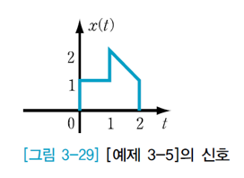
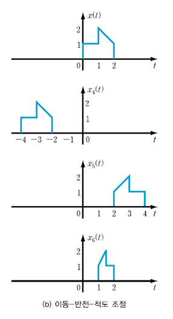

연산조합에 의한 신호 표현의 이해 해석

주어진 $x(t)$ 신호에 대해 $y(t)=x(-2t+4)$를 구하시오.

원본 신호가 정의된 정의역(t)과 이에 대응하는 치역(x(t))은 x(t) 신호에 의해서 너무나 잘 정리되어 있다. 연산조합에 의한 신호 표현이란 주제는 다른 의미로, 정의역(t-->tau)이 연산 조합으로 인해 변화($\tau=-2t+4$ 즉, t-->tau)할 때 어떻게 원래의 정의역(t)이 치역에 대응(y(t))하는지를 이해하는 주제라고 하겠다. 

즉, $t=1$ 인 경우, x(t)=1 이지만, 연산조합에 따라 y(1)=x(-2+4)=x(2)에 의해 1이 된다는 의미

연산의 조합은 (반전-척도조절)-이동, 이동-(반전-척도조절) 두 가지 경우로 생각 가능

이 때 반전과 척도조절은 하나의 세트로 묶어서 연산 (-1도 반전(-1)과 척도조절(1), -2도 반전(-1)과 척도조절(2)의 의미로 이해)

주의해야 할 것은 (반전-척도조절)이 먼저 있는 경우와 나중에 있는 경우를 비교 시 이동하는 방향과 크기가 달라질 수 있음.

